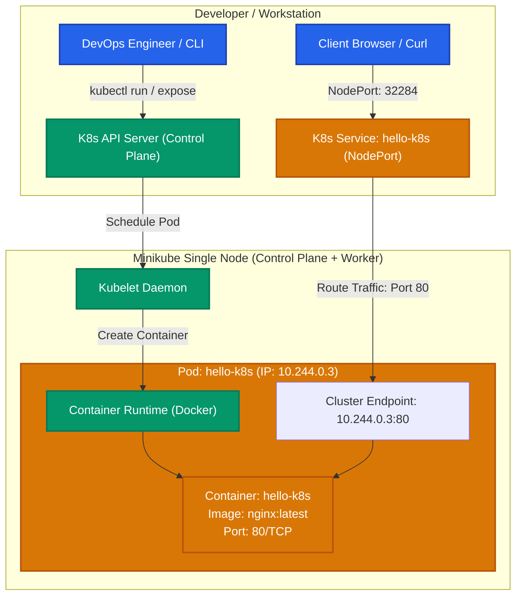

# Exercise 01: Kubernetes Getting Started (Hello Pod)

## 1. Title & Overview
**Exercise 01: Deploying an Application (Nginx) in Kubernetes and Accessing via Browser/Service**  
This exercise establishes the foundational Kubernetes concepts by setting up a local single-node cluster using Minikube, deploying an Nginx containerized web server inside a Kubernetes Pod, exposing it via a NodePort Service, and verifying connectivity.

---

## 2. Objective
- Understand core Kubernetes architecture and building blocks: Nodes, Control Plane, Pods, and Services.
- Launch a local Kubernetes cluster using Minikube with the Docker driver.
- Deploy a web storefront application simulated using the official `nginx` image (`hello-k8s`).
- Expose the application pod using a `NodePort` Service to enable external network traffic.
- Verify cluster state, inspect pod internals, view event logs, and validate HTTP connectivity.

---

## 3. Requirements & Prerequisites
- **Operating System:** Windows 11 with WSL2 / PowerShell
- **Container Runtime:** Docker Desktop 29.7+
- **Kubernetes CLI:** `kubectl` v1.36+
- **Local Kubernetes Engine:** Minikube v1.38+

---

## 4. Tools Used
| Tool | Version | Role in Architecture |
|---|---|---|
| **Minikube** | v1.38.1 | Local single-node Kubernetes cluster manager |
| **Kubectl** | v1.36.4 | Kubernetes command-line interface |
| **Docker** | 29.7.2 | Underlying container runtime engine |
| **Nginx** | Alpine/Latest | Target web server container application |

---

## 5. Architecture & Workflow Diagram



---

## 6. Implementation & Terminal-First Workflow

### Step 1: Start Minikube Cluster
```powershell
minikube start --driver=docker
```
**Output:**
```text
* minikube v1.38.1 on Microsoft Windows 11 Home Single Language
* Using the docker driver based on user configuration
* Starting "minikube" primary control-plane node in "minikube" cluster
* Creating docker container (CPUs=2, Memory=4000MB) ...
* Preparing Kubernetes v1.35.1 on Docker 29.7.2 ...
* Verifying Kubernetes components...
* Done! kubectl is now configured to use "minikube" cluster and "default" namespace by default
```

### Step 2: Deploy Nginx Image as a Pod
```powershell
kubectl run hello-k8s --image=nginx --port=80
```
**Output:**
```text
pod/hello-k8s created
```

### Step 3: Verify Pod Status and Detailed Inspection
```powershell
kubectl get pods -o wide
```
**Output:**
```text
NAME        READY   STATUS    RESTARTS   AGE   IP           NODE       NOMINATED NODE   READINESS GATES
hello-k8s   1/1     Running   0          15s   10.244.0.3   minikube   <none>           <none>
```

```powershell
kubectl describe pod hello-k8s
```
**Key Details:**
- **Pod IP:** `10.244.0.3`
- **Node:** `minikube/192.168.49.2`
- **Container ID:** `docker://6ba7b0e81ea16ee4feb3000b5bfb022e939745bcdd820a72d9ce75e27ebb8112`
- **Events:**
  - `Scheduled`: Successfully assigned default/hello-k8s to minikube
  - `Pulling`: Pulling image "nginx"
  - `Pulled`: Successfully pulled image "nginx" in 9.759s
  - `Created`: Container created
  - `Started`: Container started

### Step 4: Expose the Pod as a Service
```powershell
kubectl expose pod hello-k8s --type=NodePort --port=80
```
**Output:**
```text
service/hello-k8s exposed
```

### Step 5: Verify Service and NodePort Assignment
```powershell
kubectl get svc hello-k8s
```
**Output:**
```text
NAME        TYPE       CLUSTER-IP     EXTERNAL-IP   PORT(S)        AGE
hello-k8s   NodePort   10.104.129.1   <none>        80:32284/TCP   7s
```

---

## 7. Verification & Testing Evidence

### HTTP Access Verification via Pod IP:
```bash
minikube ssh "curl -I http://10.244.0.3:80"
```
**Output:**
```text
HTTP/1.1 200 OK
Server: nginx/1.31.7
Date: Sun, 18 Oct 2026 11:54:29 GMT
Content-Type: text/html
Content-Length: 896
Last-Modified: Thu, 01 Oct 2026 17:19:27 GMT
Connection: keep-alive
ETag: "6abe961f-380"
Accept-Ranges: bytes
```

### HTTP Access Verification via Service NodePort (32284):
```bash
minikube ssh "curl -s http://localhost:32284 | head -n 12"
```
**Output:**
```html
<!DOCTYPE html>
<html>
<head>
<title>Welcome to nginx!</title>
<style>
html { color-scheme: light dark; }
body { width: 35em; margin: 0 auto;
font-family: Tahoma, Verdana, Arial, sans-serif; }
</style>
</head>
<body>
<h1>Welcome to nginx!</h1>
<p>If you see this page, nginx is successfully installed and working.</p>
```

---

## 8. Result & Conclusion
- Successfully initialized a Kubernetes cluster using Minikube with Docker driver.
- Deployed a containerized web application inside a Pod (`hello-k8s`).
- Exposed the pod using a Kubernetes `NodePort` Service with automatic port mapping.
- Verified end-to-end communication receiving `HTTP/1.1 200 OK` and the standard Nginx welcome payload.
- All verification steps passed with zero errors.
