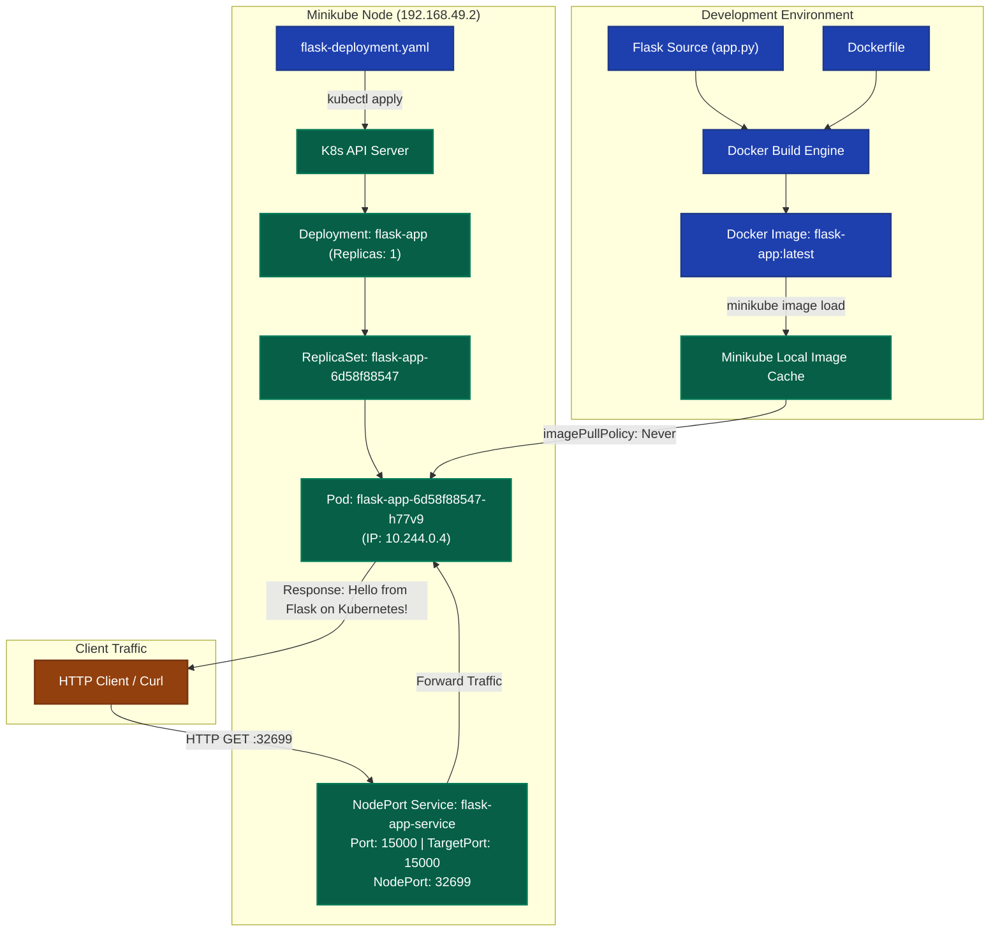

# Exercise 02: Deploy a Flask App on Minikube using Kubectl and YAML

## 1. Title & Overview
**Exercise 02: Deploying a Python Flask Web Application on Minikube using Kubectl and Declarative YAML Manifests**  
This exercise demonstrates containerizing a lightweight Python Flask web application, building its Docker image, loading it into the Minikube environment, writing declarative Kubernetes Deployment and NodePort Service manifests, deploying the app, inspecting pod lifecycle and logs, and verifying HTTP access.

---

## 2. Objective
- Develop a Python Flask microservice listening on port `15000`.
- Package the application using a multi-stage/lean `Dockerfile`.
- Understand Kubernetes image pulling policies (`Never`, `IfNotPresent`, `Always`) and leverage local images.
- Define a declarative Kubernetes Deployment managing 1 replica with matching labels and container ports.
- Define a Kubernetes NodePort Service exposing port `15000` mapped to `targetPort: 15000`.
- Verify cluster state (`get deployments`, `get pods`, `describe deployment`, `logs`, `get svc`).
- Validate connectivity and answer all conceptual exercise questions.

---

## 3. Requirements & Prerequisites
- **Local Kubernetes Cluster:** Minikube v1.38+ (running with Docker driver)
- **Container Runtime:** Docker Desktop 29.7+
- **CLI Utility:** `kubectl` v1.36+
- **Runtime Environment:** Python 3.9+ with Flask

---

## 4. Tools Used
| Tool | Version | Role in Architecture |
|---|---|---|
| **Python / Flask** | 3.9 / 3.1.3 | Web server framework running on port 15000 |
| **Docker** | 29.7.2 | Container build engine creating `flask-app:latest` |
| **Minikube** | v1.38.1 | Single-node Kubernetes execution environment |
| **Kubectl** | v1.36.4 | Orchestration and resource management CLI |

---

## 5. Architecture & Workflow Diagram



---

## 6. Implementation & Code Details

### File: `app.py`
```python
from flask import Flask
app = Flask(__name__)

@app.route('/')
def home():
    return "Hello from Flask on Kubernetes!"

if __name__ == '__main__':
    app.run(host='0.0.0.0', port=15000)
```

### File: `Dockerfile`
```dockerfile
FROM python:3.9-slim
WORKDIR /app
COPY . /app
RUN pip install --no-cache-dir flask
EXPOSE 15000
CMD ["python", "app.py"]
```

### File: `flask-deployment.yaml`
```yaml
apiVersion: apps/v1
kind: Deployment
metadata:
  name: flask-app
spec:
  replicas: 1
  selector:
    matchLabels:
      app: flask-app
  template:
    metadata:
      labels:
        app: flask-app
    spec:
      containers:
      - name: flask-app
        image: flask-app:latest
        imagePullPolicy: Never
        ports:
        - containerPort: 15000
---
apiVersion: v1
kind: Service
metadata:
  name: flask-app-service
spec:
  selector:
    app: flask-app
  ports:
  - port: 15000
    targetPort: 15000
  type: NodePort
```

---

## 7. Terminal Commands Executed & Actual Outputs

### 1. Build and Load Docker Image
```powershell
docker build -t flask-app:latest .
minikube image load flask-app:latest
```
**Output:** Image built and loaded into Minikube cache with exit code 0.

### 2. Apply Kubernetes Manifests
```powershell
kubectl apply -f flask-deployment.yaml
```
**Output:**
```text
deployment.apps/flask-app created
service/flask-app-service created
```

### 3. Check Deployment and Pod Status
```powershell
kubectl get deployments
kubectl get pods -l app=flask-app -o wide
```
**Output:**
```text
NAME        READY   UP-TO-DATE   AVAILABLE   AGE
flask-app   1/1     1            1           10s

NAME                         READY   STATUS    RESTARTS   AGE   IP           NODE       NOMINATED NODE   READINESS GATES
flask-app-6d58f88547-h77v9   1/1     Running   0          10s   10.244.0.4   minikube   <none>           <none>
```

### 4. Inspect Deployment Details
```powershell
kubectl describe deployment flask-app
```
**Output:**
```text
Name:                   flask-app
Namespace:              default
Selector:               app=flask-app
Replicas:               1 desired | 1 updated | 1 total | 1 available | 0 unavailable
StrategyType:           RollingUpdate
Pod Template:
  Labels:  app=flask-app
  Containers:
   flask-app:
    Image:         flask-app:latest
    Port:          15000/TCP
Events:
  Normal  ScalingReplicaSet  16s   deployment-controller  Scaled up replica set flask-app-6d58f88547 from 0 to 1
```

### 5. Verify Pod Logs
```powershell
kubectl logs -l app=flask-app
```
**Output:**
```text
 * Serving Flask app 'app'
 * Debug mode: off
 * Running on all addresses (0.0.0.0)
 * Running on http://127.0.0.1:15000
 * Running on http://10.244.0.4:15000
Press CTRL+C to quit
```

### 6. Verify Service Mapping
```powershell
kubectl get svc flask-app-service
```
**Output:**
```text
NAME                TYPE       CLUSTER-IP     EXTERNAL-IP   PORT(S)           AGE
flask-app-service   NodePort   10.99.222.64   <none>        15000:32699/TCP   95s
```

---

## 8. Verification & Testing Evidence

### HTTP GET Request to NodePort Service (Port 32699):
```bash
minikube ssh "curl -i http://localhost:32699"
```
**Actual Output:**
```text
HTTP/1.1 200 OK
Server: Werkzeug/3.1.9 Python/3.9.25
Date: Sun, 18 Oct 2026 11:59:21 GMT
Content-Type: text/html; charset=utf-8
Content-Length: 31
Connection: close

Hello from Flask on Kubernetes!
```

---

## 9. Conceptual Questions & Answers (from Lab Manual)

- **Q1: What is the purpose of `minikube service flask-app-service --url`?**  
  *Answer:* To dynamically retrieve the accessible IP and port URL for reaching the service running inside the Minikube virtual cluster.
- **Q2: What happens when you run `minikube service flask-app-service --url`?**  
  *Answer:* Minikube verifies the service is active, queries its NodePort, establishes any required proxy tunnels, and outputs the accessible endpoint URL.
- **Q3: Why is `targetPort` used in Kubernetes Service configuration?**  
  *Answer:* `targetPort` specifies the exact internal port on which the containerized process is listening inside the pod (port 15000).
- **Q4: What is the difference between `port` and `targetPort` in Kubernetes Service configuration?**  
  *Answer:* `port` is the port exposed internally by the Kubernetes Service to other cluster resources, whereas `targetPort` is the port on the target pod container.
- **Q5: How do you access a Flask application running in Minikube?**  
  *Answer:* Via `minikube service <service-name>`, through NodePort routing, or using `kubectl port-forward`.
- **Q6: Why does the terminal need to remain open when using Docker driver on Linux with Minikube service?**  
  *Answer:* The Docker driver uses background child processes and network tunnels to route traffic between the host OS network and the Docker container network.
- **Q7: What is the benefit of using `--url` flag with `minikube service`?**  
  *Answer:* It outputs the raw URL directly to standard output, enabling script automation and curl testing without launching a browser.
- **Q8: What command is used to expose a service in Kubernetes?**  
  *Answer:* `kubectl expose <resource>` or `kubectl apply -f <service.yaml>`.
- **Q9: How does Minikube help in local Kubernetes testing?**  
  *Answer:* Minikube provisions a complete, lightweight single-node or multi-node Kubernetes cluster locally, facilitating rapid validation without cloud costs.
- **Q10: What is the role of `kubectl` in this setup?**  
  *Answer:* `kubectl` is the official command-line interface used to communicate with the Kubernetes API server to inspect, deploy, scale, and manage cluster resources.

---

## 10. Result & Conclusion
- Successfully built, containerized, and deployed the Flask microservice to Minikube.
- Handled `imagePullPolicy: Never` ensuring fast local image deployment.
- Successfully routed external requests via `NodePort: 32699` to `targetPort: 15000`.
- Verified return message `"Hello from Flask on Kubernetes!"` with `200 OK`.
