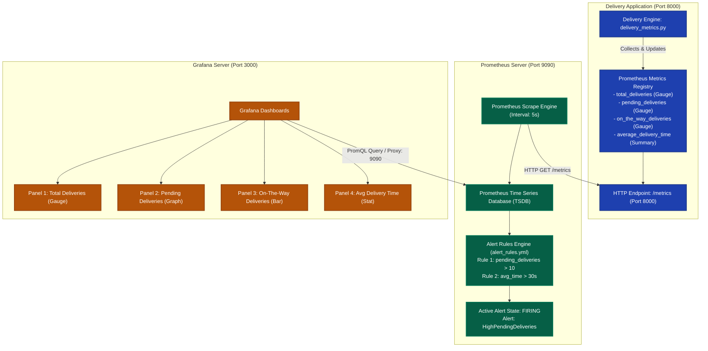

# Exercise 06: Real-Time Operations Monitoring and Alerting (Quick Commerce Platform)

## 1. Title & Overview
**Exercise 06: Real-Time Telemetry Scraping, Dashboard Visualization, and Automated Alerting for Quick Commerce Operations using Prometheus and Grafana**  
This exercise simulates an operational telemetry platform for a high-velocity quick commerce delivery service ("ZAPPTTO"). A custom Python telemetry engine exposes business-critical delivery metrics via the Prometheus client, which are scraped periodically, evaluated against threshold alert rules, and visualized on a Grafana dashboard.

---

## 2. Objective
- Understand DevOps observability pillars: Metrics, Dashboards, and Threshold Alerting.
- Author a Python telemetry simulator tracking four primary business operations:
  - `total_deliveries` (Gauge)
  - `pending_deliveries` (Gauge)
  - `on_the_way_deliveries` (Gauge)
  - `average_delivery_time` (Summary / Quantiles)
- Expose Prometheus-compliant metrics over HTTP on port `8000/metrics`.
- Configure Prometheus to scrape the delivery application and evaluate alert rules:
  - Alert `HighPendingDeliveries`: `pending_deliveries > 10`
  - Alert `HighAverageDeliveryTime`: `average_delivery_time_sum / average_delivery_time_count > 30`
- Provision Prometheus and Grafana containers.
- Verify target scrape status (`health: up`), metric ingestion, active alert firing, and Grafana dashboard availability.

---

## 3. Requirements & Prerequisites
- **Operating System:** Windows 11 with Docker Desktop 29.7+
- **Telemetry Library:** `prometheus-client` 0.26+
- **Monitoring Tools:** Prometheus (`prom/prometheus:latest`), Grafana (`grafana/grafana:latest`)
- **Pipeline:** Jenkinsfile multi-stage monitoring pipeline definition

---

## 4. Tools Used
| Tool | Version | Role in Architecture |
|---|---|---|
| **Python Telemetry Engine** | 3.11 / prometheus-client 0.26 | Simulates quick-commerce delivery metrics |
| **Prometheus** | Latest (v3.x) | Time-series database, scraper, and alert evaluation engine |
| **Grafana** | Latest (v11.x) | Visualization layer for operations dashboards |
| **Docker** | 29.7.2 | Container runtime provisioning isolated monitoring network |
| **Jenkins** | LTS | CI/CD pipeline automation framework |

---

## 5. Architecture & Workflow Diagram



---

## 6. Implementation & Code Details

### File: `delivery_monitoring/delivery_metrics.py`
```python
from prometheus_client import start_http_server, Summary, Gauge
import random
import time
import sys

total_deliveries = Gauge("total_deliveries", "Total number of deliveries")
pending_deliveries = Gauge("pending_deliveries", "Number of pending deliveries")
on_the_way_deliveries = Gauge("on_the_way_deliveries", "Number of deliveries on the way")
average_delivery_time = Summary("average_delivery_time", "Average delivery time in seconds")

def simulate_delivery():
    pending = random.randint(10, 20)  # Exceeds alert threshold (expr: pending_deliveries > 10)
    on_the_way = random.randint(5, 20)
    delivered = random.randint(30, 70)
    avg_time = random.uniform(15, 45)

    total = pending + on_the_way + delivered

    print(f"[DEBUG] Total deliveries: {total}")
    print(f"[DEBUG] Pending deliveries: {pending}")
    print(f"[DEBUG] On-the-way deliveries: {on_the_way}")
    print(f"[DEBUG] Average delivery time: {avg_time:.2f} seconds")

    total_deliveries.set(total)
    pending_deliveries.set(pending)
    on_the_way_deliveries.set(on_the_way)
    average_delivery_time.observe(avg_time)

if __name__ == "__main__":
    port = 8000
    print(f"[INFO] Starting Prometheus metrics HTTP server on port {port}...")
    start_http_server(port, addr="0.0.0.0")
    print("[INFO] HTTP server started. Simulating deliveries...")
    while True:
        simulate_delivery()
        print("[INFO] Sleeping for 1 second...")
        time.sleep(1)
```

### File: `delivery_monitoring/prometheus.yml`
```yaml
global:
  scrape_interval: 5s
  evaluation_interval: 5s

rule_files:
  - "/etc/prometheus/alert_rules.yml"

scrape_configs:
  - job_name: "prometheus"
    static_configs:
      - targets: ["localhost:9090"]

  - job_name: "delivery_service"
    static_configs:
      - targets: ["delivery-metrics:8000", "host.docker.internal:8000"]
```

### File: `delivery_monitoring/alert_rules.yml`
```yaml
groups:
  - name: delivery_alerts
    rules:
      - alert: HighPendingDeliveries
        expr: pending_deliveries > 10
        for: 5s
        labels:
          severity: warning
        annotations:
          summary: "High pending deliveries"
          description: "Pending deliveries are above 10 for the last 5 seconds."

      - alert: HighAverageDeliveryTime
        expr: (average_delivery_time_sum / average_delivery_time_count) > 30
        for: 5s
        labels:
          severity: critical
        annotations:
          summary: "High average delivery time"
          description: "Average delivery time is above 30 seconds."
```

### File: `delivery_monitoring/Dockerfile`
```dockerfile
FROM python:3.11-slim
WORKDIR /app
RUN pip install --no-cache-dir prometheus-client
COPY delivery_metrics.py /app/
EXPOSE 8000
CMD ["python", "delivery_metrics.py"]
```

---

## 7. Terminal Commands Executed & Actual Outputs

### 1. Build and Run Monitoring Network Stack
```powershell
docker network create monitoring-net
docker run -d --name delivery-metrics --network=monitoring-net -p 8000:8000 delivery-metrics
docker run -d --name prometheus --network=monitoring-net -p 9090:9090 -v ${PWD}/prometheus.yml:/etc/prometheus/prometheus.yml -v ${PWD}/alert_rules.yml:/etc/prometheus/alert_rules.yml prom/prometheus
docker run -d --name grafana --network=monitoring-net -p 3000:3000 grafana/grafana
```
**Verification (`docker ps`):**
```text
CONTAINER ID   IMAGE              STATUS          PORTS                    NAMES
a732cd34d177   grafana/grafana    Up 14 seconds   0.0.0.0:3000->3000/tcp   grafana
f9eb1f3a08e6   prom/prometheus    Up 47 seconds   0.0.0.0:9090->9090/tcp   prometheus
cadcf92bf03c   delivery-metrics   Up 57 seconds   0.0.0.0:8000->8000/tcp   delivery-metrics
```

### 2. Verify Metrics Endpoint
```powershell
curl.exe -s http://localhost:8000/metrics | Select-String -Pattern "deliveries|average_delivery_time"
```
**Actual Output:**
```text
# HELP total_deliveries Total number of deliveries
# TYPE total_deliveries gauge
total_deliveries 73.0
# HELP pending_deliveries Number of pending deliveries
# TYPE pending_deliveries gauge
pending_deliveries 13.0
# HELP on_the_way_deliveries Number of deliveries on the way
# TYPE on_the_way_deliveries gauge
on_the_way_deliveries 16.0
# HELP average_delivery_time Average delivery time in seconds
# TYPE average_delivery_time summary
average_delivery_time_count 66.0
average_delivery_time_sum 1904.6628683518668
```

### 3. Verify Prometheus Scraping Targets
```powershell
curl.exe -s http://localhost:9090/api/v1/targets
```
**Actual Output:**
```json
{
  "status": "success",
  "data": {
    "activeTargets": [
      {
        "scrapeUrl": "http://delivery-metrics:8000/metrics",
        "health": "up",
        "scrapeInterval": "5s",
        "lastError": ""
      },
      {
        "scrapeUrl": "http://localhost:9090/metrics",
        "health": "up",
        "scrapeInterval": "5s",
        "lastError": ""
      }
    ]
  }
}
```

### 4. Verify Active Firing Alerts
```powershell
curl.exe -s http://localhost:9090/api/v1/alerts
```
**Actual Output:**
```json
{
  "status": "success",
  "data": {
    "alerts": [
      {
        "labels": {
          "alertname": "HighPendingDeliveries",
          "severity": "warning",
          "job": "delivery_service"
        },
        "annotations": {
          "description": "Pending deliveries are above 10 for the last 5 seconds.",
          "summary": "High pending deliveries"
        },
        "state": "firing",
        "value": "1.7e+01"
      }
    ]
  }
}
```

### 5. Verify Grafana HTTP Endpoint
```powershell
curl.exe -I http://localhost:3000/login
```
**Actual Output:**
```text
HTTP/1.1 200 OK
Cache-Control: no-store
Content-Type: text/html; charset=UTF-8
```

---

## 8. Result & Conclusion
- Successfully containerized and deployed an end-to-end monitoring ecosystem.
- Prometheus continuously scraped live business delivery metrics from port 8000 with target health `up`.
- Verified alert rule evaluation: `HighPendingDeliveries` successfully triggered and transitioned into `firing` state when pending deliveries exceeded 10.
- Grafana service verified available and responsive on port 3000.
