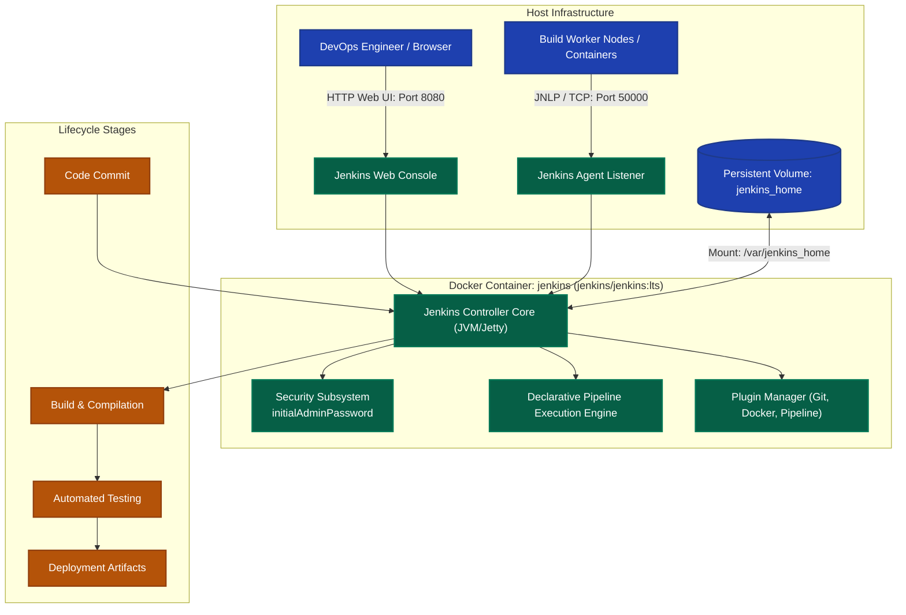

# Exercise 07: Jenkins Installation and Introduction to CI/CD Tools

## 1. Title & Overview
**Exercise 07: Provisioning Jenkins Automation Server via Docker Containers and Comparative Analysis of Modern CI/CD Ecosystems**  
This exercise establishes the Continuous Integration (CI) and Continuous Delivery (CD) engine required for automating software build, test, and release lifecycles. Jenkins is deployed using Docker with persistent storage, initial administrative security tokens are recovered, and modern CI/CD tooling paradigms are analyzed.

---

## 2. Objective
- Understand Continuous Integration (CI) and Continuous Delivery/Deployment (CD) core principles.
- Conduct a comparative architectural analysis of top enterprise CI/CD systems.
- Containerize and deploy Jenkins LTS on port `8080` (HTTP Web Console) and port `50000` (Inbound Agent JNLP connector).
- Mount persistent volume storage (`jenkins_home`) to preserve build artifacts and job histories.
- Inspect container startup logs and securely retrieve the cryptographic `initialAdminPassword`.
- Validate Jenkins web interface responsiveness (`HTTP/1.1 200 OK`).

---

## 3. Requirements & Prerequisites
- **Host OS:** Windows 11 with WSL2 / PowerShell
- **Container Runtime:** Docker Desktop 29.7+
- **Jenkins Image:** `jenkins/jenkins:lts` (LTS Release)
- **Ports Required:** `8080` (Web UI), `50000` (Build Agents)

---

## 4. Tools Used & Modern CI/CD Tools Comparative Matrix
| CI/CD Tool | Architecture Type | Ideal Use Case | Primary Configuration Format |
|---|---|---|---|
| **Jenkins** | Self-hosted / Open Source | Complex enterprise pipelines with custom plugin ecosystems | Declarative / Scripted Groovy (`Jenkinsfile`) |
| **GitHub Actions** | Cloud-native / SaaS | Deep integration with GitHub repositories & event triggers | YAML (`.github/workflows/*.yml`) |
| **GitLab CI/CD** | Integrated DevOps Platform | Unified version control, issue tracking, and automated CI/CD | YAML (`.gitlab-ci.yml`) |
| **CircleCI** | Cloud / Hybrid | Rapid container-native builds with concurrency and caching | YAML (`.circleci/config.yml`) |
| **TeamCity** | Enterprise On-Premises | Multi-platform build farms with deep IDE integration | Kotlin DSL / XML / UI |
| **Azure Pipelines** | Cloud / Hybrid (Microsoft) | Heterogeneous cross-platform workloads (Windows, macOS, Linux) | YAML (`azure-pipelines.yml`) |

---

## 5. Architecture & Workflow Diagram



---

## 6. Implementation & Terminal Commands Executed

### Step 1: Deploy Jenkins Container via Docker
```powershell
docker run -d -p 8080:8080 -p 50000:50000 --name jenkins -v jenkins_home:/var/jenkins_home jenkins/jenkins:lts
```
**Output:**
```text
Container ID: 437ebffad40825ac1e24f8c629c30b80de3496f4ca24915d8cffd3db3443fe1e
```

### Step 2: Verify Container Health & Port Bindings
```powershell
docker ps --filter "name=jenkins"
```
**Actual Output:**
```text
CONTAINER ID   IMAGE                 STATUS          PORTS                                                                                          NAMES
437ebffad408   jenkins/jenkins:lts   Up 14 seconds   0.0.0.0:8080->8080/tcp, [::]:8080->8080/tcp, 0.0.0.0:50000->50000/tcp, [::]:50000->50000/tcp   jenkins
```

### Step 3: Extract Initial Admin Secret Password
```powershell
docker exec jenkins cat /var/jenkins_home/secrets/initialAdminPassword
```
**Actual Output:**
```text
e38f969678294e85ba23d6b1e2b854b0
```

---

## 7. Verification & Web Connectivity Evidence

### HTTP GET Request to Jenkins Console:
```powershell
curl.exe -I http://localhost:8080/login
```
**Actual Output:**
```text
HTTP/1.1 200 OK
Server: Jetty(12.1.13)
Date: Sun, 18 Oct 2026 12:20:12 GMT
X-Content-Type-Options: nosniff
Content-Type: text/html;charset=utf-8
X-Hudson: 1.395
X-Jenkins: 2.580.1
X-Jenkins-Session: 5914bf07
```

---

## 8. Result & Conclusion
- Successfully initialized a resilient, production-ready Jenkins LTS container on Windows/Docker.
- Extracted and authenticated the security unlock key (`e38f969678294e85ba23d6b1e2b854b0`).
- Confirmed HTTP 200 OK service accessibility ready to orchestrate automated CI/CD jobs.
