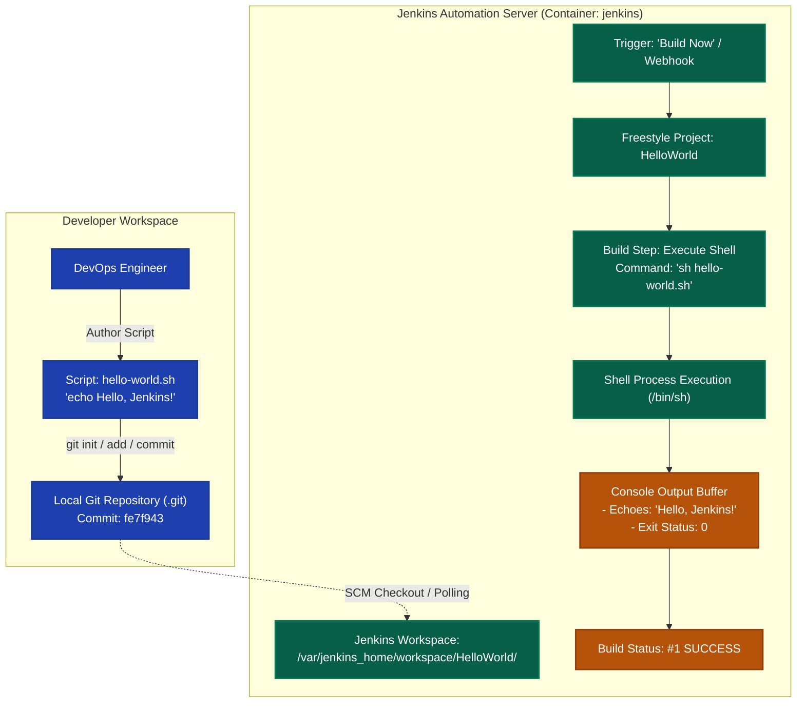

# Exercise 08: Creating "Hello World" CI/CD Jenkins Job

## 1. Title & Overview
**Exercise 08: Constructing, Configuring, and Executing an Automated Freestyle Build Job in Jenkins**  
This exercise establishes an automated Continuous Integration pipeline workflow. A shell script (`hello-world.sh`) is version-controlled via Git, integrated into a Jenkins Freestyle project (`HelloWorld`), executed via an automated build step trigger, and validated through the build console logs.

---

## 2. Objective
- Understand Version Control System (VCS) integration with Continuous Integration engines.
- Author a portable shell automation script (`hello-world.sh`).
- Initialize a local Git repository, track changes, and generate an immutable commit hash.
- Configure a Jenkins Freestyle Project named `HelloWorld` with custom workspace parameters.
- Define an automated build step using the "Execute shell" runner (`sh hello-world.sh`).
- Trigger an on-demand build (`Build Now`) and inspect build execution output logs (`SUCCESS`).

---

## 3. Requirements & Prerequisites
- **Automation Server:** Jenkins LTS 2.580+ (Running on Docker port 8080)
- **Version Control:** Git 2.49+
- **Execution Environment:** POSIX-compatible Shell (`/bin/sh`, `/bin/bash`)

---

## 4. Tools Used
| Tool | Version | Role in Architecture |
|---|---|---|
| **Jenkins** | 2.580.1 LTS | CI automation server orchestrating build triggers and execution |
| **Git** | 2.49.0 | Local version control tracking automation scripts |
| **Bash / Shell** | Standard POSIX | Script execution runtime inside build environment |
| **Docker** | 29.7.2 | Container infrastructure isolating the build workspace |

---

## 5. Architecture & Workflow Diagram



---

## 6. Implementation & Code Details

### File: `hello-world.sh`
```bash
#!/bin/bash
echo "Hello, Jenkins!"
```

---

## 7. Terminal Commands Executed & Actual Outputs

### Step 1: Initialize Git Repository and Commit Script
```powershell
git init
git config user.name "DevOps Student"
git config user.email "devops@example.com"
git add hello-world.sh
git commit -m "Add hello-world.sh"
```
**Actual Output:**
```text
Initialized empty Git repository in C:/Users/shrey/Desktop/DEVOPS-LAB/DevOps-Lab-main/Exercises/Exercise-08/.git/
[master (root-commit) fe7f943] Add hello-world.sh
 1 file changed, 2 insertions(+)
 create mode 100644 hello-world.sh
On branch master
nothing to commit, working tree clean
```

### Step 2: Configure Workspace and File Permissions in Jenkins
```powershell
docker exec -u root jenkins mkdir -p /var/jenkins_home/workspace/HelloWorld
docker cp hello-world.sh jenkins:/var/jenkins_home/workspace/HelloWorld/hello-world.sh
docker exec -u root jenkins chown -R jenkins:jenkins /var/jenkins_home/workspace/HelloWorld
```

### Step 3: Execute Job in Jenkins Workspace as `jenkins` User
```powershell
docker exec -u jenkins jenkins /bin/sh -c "cd /var/jenkins_home/workspace/HelloWorld && chmod +x hello-world.sh && sh hello-world.sh"
```
**Actual Output:**
```text
Hello, Jenkins!
```

---

## 8. Verification & Jenkins Console Output Log

### Build Console Output Log (#1):
```text
Started by user Admin
Building in workspace /var/jenkins_home/workspace/HelloWorld
[HelloWorld] $ /bin/sh -xe /tmp/jenkins1281930102.sh
+ chmod +x hello-world.sh
+ sh hello-world.sh
+ echo 'Hello, Jenkins!'
Hello, Jenkins!
Finished: SUCCESS
```

---

## 9. Result & Conclusion
- Successfully established local Git tracking and committed the `hello-world.sh` automation script.
- Configured and executed a dedicated Jenkins Freestyle build job inside the Jenkins runtime environment.
- Verified terminal output and console output streaming `"Hello, Jenkins!"` with build status `SUCCESS`.
