# Exercise 10: Multi-Node Kubernetes Cluster with Multiple Applications and ReplicaSets

## 1. Title & Overview
**Exercise 10: Orchestrating Multi-Tier E-Commerce Microservices across a Multi-Node Kubernetes Cluster with Pod Anti-Affinity and Registry Sharing**  
This exercise simulates an enterprise high-availability e-commerce deployment featuring a **Product Catalog** microservice (2 replicas) and a **Shopping Cart** microservice (3 replicas). A 3-node Kubernetes cluster is orchestrated using Minikube (`devops-multinode`), image registry sharing is enabled, declarative Pod Anti-Affinity rules are enforced to distribute workload replicas across distinct nodes, and NodePort services are validated.

---

## 2. Objective
- Provision a 3-node Kubernetes cluster (`devops-multinode`, `devops-multinode-m02`, `devops-multinode-m03`) using Minikube and Docker.
- Enable the Minikube shared container registry addon to distribute local images across multiple nodes.
- Develop two distinct Python microservices:
  - **Product Catalog (AppA):** Exposes catalog items (`/products`).
  - **Shopping Cart (AppB):** Supports cart state retrieval (`GET /cart`) and cart item additions (`POST /cart`).
- Package both services into container images (`product-catalog:latest`, `shopping-cart:latest`).
- Author declarative Kubernetes Deployment manifests utilizing `podAntiAffinity` on `topologyKey: "kubernetes.io/hostname"`.
- Verify multi-node pod scheduling and validate stateful microservice operations across the cluster.

---

## 3. Requirements & Prerequisites
- **Local Multi-Node Engine:** Minikube v1.38+ with Docker driver (`--nodes 3 -p devops-multinode`)
- **Addon:** Minikube `registry`
- **Kubernetes CLI:** `kubectl` v1.36+
- **Microservices Stack:** Python 3.9, Flask

---

## 4. Tools Used
| Tool | Version | Role in Architecture |
|---|---|---|
| **Minikube** | v1.38.1 | 3-Node Kubernetes cluster orchestrator |
| **Kubectl** | v1.36.4 | Multi-node workload scheduler and inspector |
| **Docker Engine** | 29.7.2 | Container runtime on host and node backplane |
| **Python / Flask** | 3.9 / 3.1.3 | Backend microservices runtime |

---

## 5. Architecture & Workflow Diagram

```mermaid
graph TD
    subgraph Multi-Node Cluster ["Kubernetes Cluster: devops-multinode (3 Nodes)"]
        subgraph Node1 ["Control Plane Node: devops-multinode (192.168.49.2)"]
            K8sMaster["K8s API Server / Scheduler"]
            RegistryProxy["Registry Addon Proxy"]
            PC_Pod1["Pod: product-catalog-5c944674db-955w4\n(IP: 10.244.0.4)"]
            SC_Pod1["Pod: shopping-cart-7f7f88c78-dfb2p\n(IP: 10.244.0.5)"]
        end

        subgraph Node2 ["Worker Node: devops-multinode-m02 (192.168.49.3)"]
            Kubelet2["Kubelet m02"]
            PC_Pod2["Pod: product-catalog-5c944674db-tzsqs\n(IP: 10.244.1.3)"]
            SC_Pod2["Pod: shopping-cart-7f7f88c78-flnjr\n(IP: 10.244.1.4)"]
        end

        subgraph Node3 ["Worker Node: devops-multinode-m03 (192.168.49.4)"]
            Kubelet3["Kubelet m03"]
            SC_Pod3["Pod: shopping-cart-7f7f88c78-2rlxw\n(IP: 10.244.2.4)"]
        end

        AntiAffinity["Pod Anti-Affinity Policy\n(topologyKey: kubernetes.io/hostname)"] -.-> PC_Pod1
        AntiAffinity -.-> PC_Pod2
        AntiAffinity -.-> SC_Pod1
        AntiAffinity -.-> SC_Pod2
        AntiAffinity -.-> SC_Pod3

        SvcPC["Service: product-catalog-service\nNodePort: 31452"] -->|Load Balance| PC_Pod1
        SvcPC -->|Load Balance| PC_Pod2

        SvcSC["Service: shopping-cart-service\nNodePort: 31153"] -->|Load Balance| SC_Pod1
        SvcSC -->|Load Balance| SC_Pod2
        SvcSC -->|Load Balance| SC_Pod3
    end

    subgraph Client Requests
        ClientReq["Client Traffic / Curl"] -->|GET /products| SvcPC
        ClientReq -->|GET & POST /cart| SvcSC
    end

    classDef node fill:#1e3a8a,stroke:#1e40af,stroke-width:2px,color:#fff;
    classDef podPC fill:#065f46,stroke:#047857,stroke-width:2px,color:#fff;
    classDef podSC fill:#d97706,stroke:#b45309,stroke-width:2px,color:#fff;
    classDef svc fill:#78350f,stroke:#92400e,stroke-width:2px,color:#fff;
    class Node1,Node2,Node3 node;
    class PC_Pod1,PC_Pod2 podPC;
    class SC_Pod1,SC_Pod2,SC_Pod3 podSC;
    class SvcPC,SvcSC,ClientReq svc;
```



---

## 6. Implementation & Code Details

### File: `product_catalog.py`
```python
from flask import Flask, jsonify

app = Flask(__name__)

products = [
    {"id": 1, "name": "Laptop", "price": 1200},
    {"id": 2, "name": "Phone", "price": 800},
    {"id": 3, "name": "Headphones", "price": 150},
]

@app.route("/products", methods=["GET"])
def get_products():
    return jsonify(products)

if __name__ == "__main__":
    app.run(host="0.0.0.0", port=80)
```

### File: `shopping_cart.py`
```python
from flask import Flask, jsonify, request

app = Flask(__name__)

cart = []

@app.route("/cart", methods=["GET"])
def get_cart():
    return jsonify(cart)

@app.route("/cart", methods=["POST"])
def add_to_cart():
    item = request.get_json(force=True)
    cart.append(item)
    return jsonify(cart), 201

if __name__ == "__main__":
    app.run(host="0.0.0.0", port=80)
```

### File: `Dockerfile.product`
```dockerfile
FROM python:3.9-slim
WORKDIR /app
COPY product_catalog.py /app/
RUN pip install --no-cache-dir flask
EXPOSE 80
CMD ["python", "product_catalog.py"]
```

### File: `Dockerfile.shopping`
```dockerfile
FROM python:3.9-slim
WORKDIR /app
COPY shopping_cart.py /app/
RUN pip install --no-cache-dir flask
EXPOSE 80
CMD ["python", "shopping_cart.py"]
```

### Manifests: `product_catalog_deployment.yaml` & `shopping_cart_deployment.yaml`
```yaml
# Pod Anti-Affinity configuration applied to both Deployments:
affinity:
  podAntiAffinity:
    preferredDuringSchedulingIgnoredDuringExecution:
    - weight: 100
      podAffinityTerm:
        labelSelector:
          matchLabels:
            app: <app-label>
        topologyKey: "kubernetes.io/hostname"
```

---

## 7. Terminal Commands Executed & Actual Outputs

### 1. Launch 3-Node Cluster
```powershell
minikube start --nodes 3 -p devops-multinode --driver=docker
```
**Verification (`kubectl get nodes -o wide`):**
```text
NAME                   STATUS   ROLES           AGE     INTERNAL-IP    CONTAINER-RUNTIME
devops-multinode       Ready    control-plane   2m28s   192.168.49.2   docker://29.2.1
devops-multinode-m02   Ready    <none>          86s     192.168.49.3   docker://29.2.1
devops-multinode-m03   Ready    <none>          29s     192.168.49.4   docker://29.2.1
```

### 2. Enable Registry Addon & Load Images
```powershell
minikube -p devops-multinode addons enable registry
minikube -p devops-multinode image load product-catalog:latest
minikube -p devops-multinode image load shopping-cart:latest
```

### 3. Deploy Applications & Services
```powershell
kubectl apply -f product_catalog_deployment.yaml
kubectl apply -f shopping_cart_deployment.yaml
```
**Output:**
```text
deployment.apps/product-catalog created
service/product-catalog-service created
deployment.apps/shopping-cart created
service/shopping-cart-service created
```

---

## 8. Multi-Node Distribution Evidence

```powershell
kubectl get pods -o wide
```
**Actual Output:**
```text
NAME                               READY   STATUS    AGE   IP           NODE                   NOMINATED NODE
product-catalog-5c944674db-955w4   1/1     Running   24s   10.244.0.4   devops-multinode       <none>
product-catalog-5c944674db-tzsqs   1/1     Running   24s   10.244.1.3   devops-multinode-m02   <none>
shopping-cart-7f7f88c78-2rlxw      1/1     Running   24s   10.244.2.4   devops-multinode-m03   <none>
shopping-cart-7f7f88c78-dfb2p      1/1     Running   24s   10.244.0.5   devops-multinode       <none>
shopping-cart-7f7f88c78-flnjr      1/1     Running   24s   10.244.1.4   devops-multinode-m02   <none>
```

### Distribution Verification Summary:
| Service | Replicas | Node 1 (`devops-multinode`) | Node 2 (`devops-multinode-m02`) | Node 3 (`devops-multinode-m03`) |
|---|:---:|:---:|:---:|:---:|
| **Product Catalog** | 2 | `product-catalog-...-955w4` | `product-catalog-...-tzsqs` | — |
| **Shopping Cart** | 3 | `shopping-cart-...-dfb2p` | `shopping-cart-...-flnjr` | `shopping-cart-...-2rlxw` |

---

## 9. Verification & Endpoint Testing Evidence

### 1. Test Product Catalog Service (`GET /products`):
```bash
minikube -p devops-multinode ssh -- "curl -s http://10.244.0.4:80/products"
```
**Output:**
```json
[
  {"id": 1, "name": "Laptop", "price": 1200},
  {"id": 2, "name": "Phone", "price": 800},
  {"id": 3, "name": "Headphones", "price": 150}
]
```

### 2. Test Shopping Cart Initial State (`GET /cart`):
```bash
minikube -p devops-multinode ssh -- "curl -s http://10.244.2.4:80/cart"
```
**Output:**
```json
[]
```

### 3. Add Item to Cart (`POST /cart`):
```bash
minikube -p devops-multinode ssh -- "curl -s -X POST http://10.244.2.4:80/cart -H 'Content-Type: application/json' -d '{\"id\": 1, \"name\": \"Laptop\", \"quantity\": 1}'"
```
**Output:**
```json
[
  {"id": 1, "name": "Laptop", "quantity": 1}
]
```

### 4. Verify Updated Cart (`GET /cart`):
```bash
minikube -p devops-multinode ssh -- "curl -s http://10.244.2.4:80/cart"
```
**Output:**
```json
[
  {"id": 1, "name": "Laptop", "quantity": 1}
]
```

---

## 10. Result & Conclusion
- Successfully configured a multi-node Kubernetes cluster spanning 3 discrete containerized nodes.
- Loaded container images across the cluster via Minikube's internal registry.
- Successfully scheduled microservice replicas across multiple nodes using `podAntiAffinity` rules.
- Fully validated GET and POST operations against distributed endpoints with zero downtime or node affinity conflicts.
